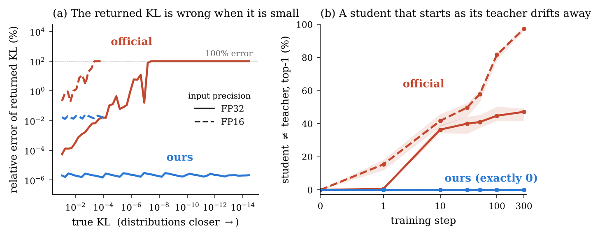
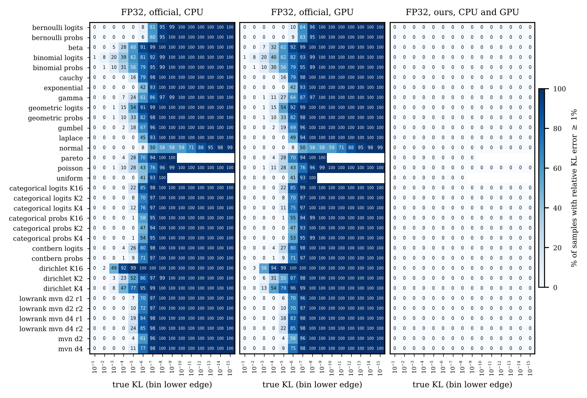

# stablekl: KL divergences for PyTorch that stay correct when the distributions are close

[](LICENSE)
[](LICENSE-DATA)
[](https://huggingface.co/datasets/xi-xiaoran/stablekl-benchmark)


The KL divergence is never negative, but PyTorch's implementations return negative values, zeros and
wrong gradients exactly where the divergence is used most often: between two distributions that are almost
equal (a student next to its teacher, a policy next to its reference, a quantised model next to the original).

<p align="center"></p>

*(a) Relative error of `kl_divergence(Exponential, Exponential)` against the exact value as the two
distributions approach each other: the official result is 100% wrong below a KL of about 1e-7 (float32) or 1e-4
(float16); the repair stays at the rounding level. (b) A student initialised as an exact copy of its teacher and
trained to minimise the KL between them (vocabulary 151,936, Adam, learning rate 1e-2, 10 seeds): with the official
KL its top-1 prediction drifts away from the teacher's; with the repair it agrees with the teacher on every token.*

This repository contains

* **`stablekl`**, a drop-in package with repaired versions of `torch.distributions.kl_divergence`
  (18 same-family pairs), `torch.nn.functional.kl_div`, and a KL computed directly from logits;
* **the benchmark** used to measure the errors: 8.5 million inputs with certified, correctly rounded
  reference values (exact interval arithmetic), the official PyTorch outputs on them, and the scoring code;
* **the experiments** of the paper and the scripts that redraw its figures.

```python
>>> import torch, stablekl
>>> from torch.distributions import Normal, kl_divergence
>>> p, q = Normal(torch.tensor(0.0), torch.tensor(1.0)), Normal(torch.tensor(1e-4), torch.tensor(1.0))
>>> kl_divergence(p, q)            # exact value: 5.0e-09
tensor(0.)
>>> stablekl.kl_divergence(p, q)
tensor(5.0000e-09)
```

```python
>>> t = torch.randn(1, 32000); s = t + 1e-4 * torch.randn(1, 32000)      # logits of two nearby models
>>> from torch.distributions import Categorical
>>> kl_divergence(Categorical(logits=t.half()), Categorical(logits=s.half()))
tensor([-3.2783e-06], dtype=torch.float16)                                # negative
>>> stablekl.logits_kl(t, s)                                              # float64 reference: 4.9108e-09
tensor(4.9108e-09)
```

(The numbers depend on the random draw; the first example is deterministic.)

---

## Contents

1. [Installation](#installation)
2. [Using the repaired functions](#using-the-repaired-functions)
3. [What is wrong with the official implementations](#what-is-wrong-with-the-official-implementations)
4. [Repository layout](#repository-layout)
5. [Data](#data)
6. [Reproducing the paper](#reproducing-the-paper)
7. [Tests](#tests)
8. [Earlier reports](#earlier-reports)
9. [Limitations](#limitations)
10. [Citation and licenses](#citation-and-licenses)

## Installation

```bash
pip install .                 # Python >= 3.10, torch >= 2.1, numpy, mpmath
pip install ".[test]"         # adds pytest
```

The package is pure Python on top of PyTorch and runs on CPU and GPU. The benchmark additionally needs
[python-flint](https://pypi.org/project/python-flint/) (exact interval arithmetic): for certifying new
reference values, and for scoring interface B. Scoring interface A on the released data needs only torch,
numpy and mpmath.

## Using the repaired functions

| Official call | Repaired call | Notes |
|---|---|---|
| `torch.distributions.kl_divergence(p, q)` | `stablekl.kl_divergence(p, q)` | same-family pairs listed below; autograd w.r.t. the parameters of `p` and `q` |
| `torch.nn.functional.kl_div(input, target, ...)` | `stablekl.kl_div(input, target, ...)` | same arguments (`reduction`, `log_target`) and semantics |
| `kl_divergence(Categorical(logits=t), Categorical(logits=s)).mean()` | `stablekl.logits_kl(t, s)` | KL(softmax(t) ‖ softmax(s)) from raw logits, mean over rows; float16, bfloat16, float32 |

**Supported families of `stablekl.kl_divergence`:** Bernoulli (probs, logits), Beta, Binomial (probs, logits),
Categorical (probs, logits), Cauchy, ContinuousBernoulli (probs, logits), Dirichlet, Exponential, Gamma,
Geometric (probs, logits), Gumbel, Laplace, LowRankMultivariateNormal, MultivariateNormal, Normal, Pareto,
Poisson, Uniform. Parameters may be float16 or float32 (float64 is accepted and evaluated without a wider type).
Pairs of different families raise `NotImplementedError`.

**Modes.** Every function evaluates the repaired formula; `mode` chooses the arithmetic.

| `mode` | `kl_divergence` | `kl_div` |
|---|---|---|
| `"ours"` (default) | evaluated in float64, rounded once to the input dtype (value and gradients) | float64 internals, one rounding; a guard falls back to exact interval evaluation, so every output is the correctly rounded value of the given inputs |
| `"rewrite"` | evaluated in the input dtype, no wider type | official element formula with repaired backward pass, scaling and boundary handling |
| `"ours32"` | – | float32 internals for float16 inputs (cheaper, not always correctly rounded) |

**Two things to know.**

* `stablekl.kl_div` returns the exact KL *of the tensors it is given*. If the target is `softmax(x)` and the
  input `log_softmax(x)` of the same logits, both are rounded separately and their exact KL is small but not
  zero. To compare two models, pass the logits to `stablekl.logits_kl`.
* `torch.distributions.Categorical` normalises its parameters when it is constructed, in the working
  precision. `stablekl.kl_divergence` repairs the KL of the normalised parameters it receives; for the KL of the
  raw logits use `stablekl.logits_kl`.

**Cost.** The repair is written as compositions of tensor operations in Python, without fused kernels. On a GPU,
`mode="ours"` costs 3.4–12× the official call for Exponential, Laplace, Poisson, Normal and Bernoulli (`"rewrite"`:
2.4–5.9×); Gamma and Beta are much slower (about 30× and 320×) because their repairs evaluate a quadrature.
The repaired `kl_div` is 27–59× slower than the official compiled kernel on a GPU (28–222× on CPU, growing with
the number of classes), and `logits_kl` 3–22×. Timing scripts: `experiments/cost/`.

## What is wrong with the official implementations

The textbook closed forms subtract nearly equal quantities (for example `log(s2/s1) + (s1² + (m1-m2)²)/(2 s2²) - 1/2`
for two Normals). When the distributions are close, the true KL is far smaller than the terms, and the rounding
error of the terms dominates the result. On the benchmark data:

* more than 85% of the returned values are off by at least 1% once the true KL falls below about 1e-7 in float32
  (1e-3 in float16), up to 30% are negative, and gradients lose their direction, on CPU and GPU alike;
* evaluating the same formulas one precision higher still leaves 7–51% of the float32 values significantly
  wrong for 22 of the 23 parameterisations;
* clamping at zero removes the sign, not the error.

<p align="center"></p>

*Share of samples whose returned KL has a relative error of at least 1%, per distribution (rows) and interval of
the true KL (columns), float32 inputs. Left and middle: the official implementation on CPU and on a GPU. Right: the
repair, on both devices. Blank cells cannot be constructed on the float32 grid.*

The repair writes each divergence as a sum of non-negative terms built from exactly computed differences,
with analytic gradients (`stablekl/_closed/` has one module per family; the derivations are in the paper's
appendix). In the working precision alone it removes more than 97% of the significant errors; evaluated one
precision higher with a single rounding (`mode="ours"`) it leaves none on 7.2 million scored closed-form inputs
and is correctly rounded on all 567 million scored components of `F.kl_div`.

## Repository layout

```
stablekl/                    the package
  closed_form.py             kl_divergence: dispatch on the distribution family
  api_b.py, interface_b.py   kl_div
  logits.py                  logits_kl
  _closed/                   one module per family: repaired formula, analytic gradients, both modes
tests/                       unit tests of the package
benchmark/
  interface_a/klbench/       interface A benchmark: input generation, certified truth (python-flint),
                             official runner, scorer
  interface_b/kldivbench/    interface B benchmark: generation, certified truth, official runner, scorer, reports
  interface_b/kldivbench2/   acceptance harness of the repaired kl_div
  evaluate_a.py              recompute official + repaired outputs on the released data (CPU or GPU) and score them
  evaluate_a_bins.py         the same scores per (KL interval x parameter region), as used for the heatmaps
  gpu/run_official_b.py      official kl_div on a GPU against the released truth
  tests/                     benchmark tests
experiments/                 downstream experiments (see below); experiments/common holds shared helpers
figures/                     scripts that redraw the paper's figures from results/
results/                     small derived results needed by figures/
scripts/                     run_interface_a.sh, run_interface_b.sh, env.sh, a Slurm array template
docs/                        DATA.md (file formats), REPRODUCE.md (paper item -> command)
```

## Data

The frozen benchmark data (10 GB) are on Hugging Face: <https://huggingface.co/datasets/xi-xiaoran/stablekl-benchmark>. Download all of it, or one configuration:

```bash
huggingface-cli download --repo-type dataset xi-xiaoran/stablekl-benchmark --local-dir data
huggingface-cli download --repo-type dataset xi-xiaoran/stablekl-benchmark --local-dir data --include "interface_a/*/normal/*"
```

File formats and checksums: [docs/DATA.md](docs/DATA.md). After download the layout is

```
data/
  interface_a/frozen/<config>/<fp16|fp32>/<unit>.npz          inputs + certified truth (value and gradients)
  interface_a/official_cpu/<config>/<fp16|fp32>/<unit>__<A|B32|B64>.npz   official PyTorch outputs on CPU
  interface_b/<config>/{inputs,truth,out}/<unit>.npz          inputs, certified truth, official outputs
  SHA256SUMS
```

Every `.npz` has a `.npz.manifest.json` whose `sha256` the loaders check. Floating-point values are stored as
their bit patterns (`uint16` / `uint32`), so nothing is lost to decimal conversion. `A` is the official
implementation; `B32` and `B64` are the official formula evaluated in float32 / float64 and rounded to the input
dtype.

## Reproducing the paper

[docs/REPRODUCE.md](docs/REPRODUCE.md) maps every table and figure to a command. In short:

| Level | What | Needs | Time |
|---|---|---|---|
| 0 | package tests, figures from `results/` | this repository | minutes |
| 1 | score the released official outputs and the repairs on the released data (main tables, heatmaps) | data download | CPU hours per configuration; a cluster for all 53 |
| 2 | downstream experiments 1–3 (Geometric fit, Bayesian design, identical-start distillation) | CPU (Exp. 1–2), one GPU (Exp. 3 grid) | hours |
| 3 | experiment 4 (quantised LLM, circuit analysis) and the settings without an effect | GPU, public checkpoints and datasets downloaded by the scripts | GPU hours |

```bash
source scripts/env.sh
python -m pytest tests                                     # level 0
python figures/fig1_overview.py                             # figures land in figures/out/
DATA=data bash scripts/run_interface_a.sh normal cpu 8      # level 1, one interface-A configuration
DATA=/path/to/copy/of/data/interface_b bash scripts/run_interface_b.sh 0 fp32 16 cpu   # one interface-B configuration
```

Model checkpoints (Qwen2.5-1.5B-Instruct, GPT-2) and datasets (WikiText-2 and the circuit-analysis tasks of
`auto-circuit`) are not redistributed; the scripts take their paths as arguments.

## Tests

```bash
python -m pytest tests                                          # package
source scripts/env.sh
python -m pytest benchmark/tests/interface_a                    # interface A benchmark
python benchmark/tests/interface_b/test_truth.py                # interface B truth
python benchmark/tests/interface_b/test_score.py                # interface B scorer and pipeline
python benchmark/tests/interface_b_acceptance/test_kldivfix.py  # repaired kl_div against exact arithmetic
python benchmark/tests/interface_b_acceptance/test_harness2.py runs/harness  # end-to-end acceptance harness
```

The reference-side tests of interface A are meant to run in an environment **without** torch
(`test_reference_import_isolated_from_torch` checks this); install python-flint, mpmath, numpy and pytest
only. Five precision self-checks in `benchmark/tests/interface_a/ref/test_certify.py` are marked as known
failures (see [Limitations](#limitations)).

## Earlier reports

The failure for nearly identical distributions has been reported by users for years. The answers usually
recommend clamping the result at zero, which removes the sign but not the error, and leaves the gradient
unchanged. A non-exhaustive list:

* PyTorch forum 48470 (2019): the `Categorical` KL of two close distributions is negative, and the `probs` and
  `logits` parameterisations disagree. https://discuss.pytorch.org/t/48470
* pytorch/pytorch#32520 (2020): `F.kl_div` is negative, or non-zero where it should be zero; closed when
  `log_target` was added in 1.6. https://github.com/pytorch/pytorch/issues/32520
* pytorch/pytorch#80488 (2022): `F.kl_div` is still negative; answered as numerical error to be clamped.
  https://github.com/pytorch/pytorch/issues/80488
* PyTorch forum 149312 (2022): under automatic mixed precision the `Categorical` KL is negative in more than
  40% of the cases. https://discuss.pytorch.org/t/149312
* PyTorch forum 166383 (2023): `F.kl_div` is negative for nearly equal outputs; answered as expected
  floating-point error. https://discuss.pytorch.org/t/166383

## Limitations

* **Scope.** Same-family pairs of `kl_divergence` only; cross-family closed forms are untouched. bfloat16 is
  supported by `logits_kl` only.
* **float16 MultivariateNormal / LowRankMultivariateNormal.** PyTorch has no float16 linear-algebra kernels, so
  the official KL does not run in float16; these cells are not part of the benchmark and the package rejects them.
* **Two cells of `kl_div`.** float16, `log_target=True`, backward, K = 2 and 4: the repaired gradients fail only
  the vector-cosine criterion of the acceptance protocol, because of the float16 format itself (paper,
  appendix on interface B).
* **Speed.** No fused kernels; see "Cost" above.
* **Known test failures.** Five self-checks in `test_certify.py` (one fixed regression anchor, one retry test and
  three finite-difference gradient checks) fail in the reference environment (python-flint 0.9.0) because the
  tolerance they assert is tighter than the test's own arithmetic provides; they are marked `xfail`. The
  certified values themselves are checked by the other tests of that file and by the scorer's cross-checks.

## Citation and licenses

The paper is under review; citation information will be added after the review period.

* Code: BSD 3-Clause License ([LICENSE](LICENSE)).
* Data: Creative Commons Attribution 4.0 International ([LICENSE-DATA](LICENSE-DATA)).
